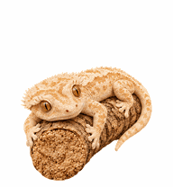
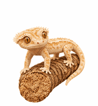
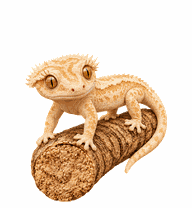

# An An · Crested Gecko Desktop Pet

Give a little crested gecko a home on your desktop.

Meet An An, a cream-colored crested gecko with a slightly goofy expression and a favorite cork branch. While you work, it keeps you company in a corner of your screen, occasionally looking up, waving a little foot, or making a gentle hop.

This project is for crested gecko lovers, including those who cannot keep one at home because of housing, family, time, or other circumstances. If you love these little geckos, let An An make itself at home on your desktop.

<p align="center">
  
  
  
</p>

## Install in Codex

1. On GitHub, select **Code → Download ZIP** to download this project.
2. Drag the ZIP file directly into a Codex chat, or give Codex its full local path, and say:

   > Install the An An virtual pet from this ZIP file into Codex on this computer. Use the included artwork and verify that the installation succeeds.

3. Once installation finishes, open **Settings → Pets → Refresh** and select **An An**.
4. Enter `/pet` to show your desktop companion.

See the [installation guide](INSTALL.md) for detailed instructions. You can also give Codex the [installation prompt](INSTALL_PROMPT.txt).

## Meet An An

- Cream markings, detailed skin textures, and a favorite cork branch.
- Nine animation states: resting, moving right, moving left, waving, jumping, blocked, waiting, working, and reviewing.
- Sixteen look directions for the client's directional interactions.
- Transparent artwork with a 3D-rendered appearance.


[Watch the video](previews/all-states.mp4) · [Look directions](previews/look-directions.gif) · [Resting and jumping](previews/idle-jump-idle.gif)

GIF and video previews use a white background for presentation. The installation artwork has a transparent background. An An uses 2D sprite animation to create a 3D-rendered appearance.

## Artwork and interaction

The repository provides one installation sprite sheet: `assets/anan.png`. It contains nine animations, sixteen look directions, and a neutral pose. The layout is 8 columns × 11 rows, measuring 1536 × 2288 pixels, with 192 × 208 pixels per cell.

[animation.json](animation.json) records animation order and timing. [pet.json](pet.json) provides the local installation manifest. Its format fields let the app read the artwork correctly.

The Codex client controls animation triggers, pointer tracking, and responses to task activity. See [Animation and interaction](INTERACTION.md) for details.

## Verify the files

Run this command from the repository folder:

```sh
python scripts/verify_assets.py
```

The script uses the Python standard library to check the artwork checksum, image dimensions, animation metadata, and installation manifest.

This is an independent community pet project.
